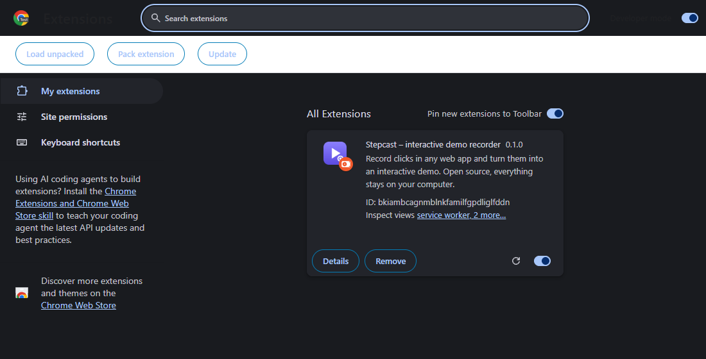

<p align="center"></p>

<h1 align="center">Stepcast</h1>

<p align="center"><b>Turn a few clicks in any website into a demo people can click through themselves.</b><br>
Free and open source. No account, no subscription. Everything stays on your computer.</p>

<p align="center">
  <a href="https://arda-dd.github.io/stepcast/"><b>▶ Try a live demo</b></a> ·
  <a href="#install-the-chrome-extension">Install</a> ·
  <a href="#make-your-first-demo">Make your first demo</a> ·
  <a href="#share-your-demo">Share</a> ·
  <a href="#faq">FAQ</a> ·
  <a href="README.tr.md">Türkçe</a>
</p>

<p align="center">
  <a href="https://github.com/Arda-dd/stepcast/actions/workflows/ci.yml"></a>
  <a href="https://github.com/Arda-dd/stepcast/releases/latest"></a>
  <a href="LICENSE"></a>
</p>

<p align="center"></p>

## What is Stepcast?

Think of it as a **slideshow of your website that the viewer clicks through**.

Each slide is a screenshot with a pulsing dot on the button to press and a short note ("Click *New project*"). When the viewer clicks the dot, the next slide appears. They learn the product by doing it, at their own pace, and they can't break anything.

You don't have to take the screenshots yourself:

1. **Record.** Start Stepcast and use your website normally. Every click becomes a slide.
2. **Edit.** Rewrite the notes, zoom into important buttons, blur private information.
3. **Share.** Download one HTML file. Send it to someone, or put it on your website.

**Who is it for?**

| You are… | Use it to… |
| --- | --- |
| a developer or agency | show a client how to use the admin panel you built, instead of explaining it on every call |
| a startup | put a "try the product" demo on your landing page, no sign-up required |
| a support team | answer "how do I…?" questions with a demo instead of a long email |
| a teacher or trainer | make click-along tutorials for any web tool |

**Why not the existing tools?** Arcade, Supademo and Storylane do the same thing, but cost [$32–50 per user per month](https://saltfish.ai/blog/storylane-alternatives) and keep your screenshots on their servers. Stepcast is free, keeps everything in your browser, and gives you a file you own.

## Install the Chrome extension

The extension does the recording. It takes about a minute, and you only do it once.

> Stepcast is not in the Chrome Web Store, so it is installed from GitHub. Chrome calls this "loading an unpacked extension". It is the same mechanism developers use to test their own extensions.

**1. Download.** Go to the [latest release](https://github.com/Arda-dd/stepcast/releases/latest) and download **`stepcast-extension.zip`** (under *Assets*).

**2. Unzip.** Right-click the file → **Extract All** (Windows) or double-click it (Mac). You get a folder named `stepcast-extension`. Keep this folder; Chrome loads the extension from it, so don't delete it later.

**3. Open the extensions page.** Type `chrome://extensions` in Chrome's address bar and press Enter.

**4. Turn on Developer mode.** Use the switch in the **top-right corner**. Three buttons appear on the left.

**5. Load the extension.** Click **Load unpacked** and select the `stepcast-extension` folder from step 2 (the folder itself, not a file inside it).

<p align="center"></p>

**6. Pin it.** Click the puzzle-piece icon 🧩 next to Chrome's address bar and click the pin next to **Stepcast**, so its button is always visible.

That's it. ✅

<details>
<summary><b>Edge, Brave, Opera, Arc…</b></summary>

Any browser based on Chromium (version 116 or newer) works. Only the address of the extensions page changes:

| Browser | Address | Developer mode switch |
| --- | --- | --- |
| Chrome | `chrome://extensions` | top-right |
| Edge | `edge://extensions` | left sidebar |
| Brave | `brave://extensions` | top-right |
| Opera | `opera://extensions` | top-right |

Firefox and Safari can't *record* yet, but everyone can *view* the demos you make, in any browser.
</details>

<details>
<summary><b>Updating and uninstalling</b></summary>

- **Update:** download the new zip, unzip it over the old folder (replace the files), then click the ↻ reload icon on the Stepcast card in `chrome://extensions`. Your demos are kept.
- **Uninstall:** click **Remove** on the Stepcast card. This also deletes the demos stored in the extension, so export the ones you want to keep first.
- Chrome may show a "Disable developer mode extensions" notice from time to time. Choose **Keep** (or just close it).
</details>

## Make your first demo

**1. Start recording.** Open the website you want to show and click the Stepcast button in the toolbar, then **Start recording this tab**.

<p align="center"></p>

**2. Click through your flow.** Use the site normally, as if you were showing someone. A small pill in the bottom-right corner counts the steps. Don't worry about it: it never appears in the screenshots.

<p align="center"></p>

Tips:
- **Go slowly.** Wait until the page has finished changing before the next click; each step shows the page the way it looked just before you clicked.
- **Typing is not a step.** Click into a field, type, then click the next button. The next step will show what you typed.
- Recording keeps going when you move to other pages on the same tab.

**3. Stop.** Click **Stop** in the pill (or in the toolbar popup). The editor opens with one step per click.

**4. Polish it in the editor.**

<p align="center"></p>

| To… | Do this |
| --- | --- |
| change a note | select the step on the left and edit **Tooltip** on the right |
| move the dot | with the **Hotspot** tool, click or drag on the screenshot |
| zoom into a button | move the **Zoom into hotspot** slider; the dashed frame shows what will be visible |
| hide an email, a name, a key | choose **Blur** and drag a box over it |
| add an intro or a note without a click | duplicate a step (⧉) and switch **Hotspot** off: it becomes a text card |
| reorder or delete steps | drag the thumbnails; hover one for ⧉ duplicate and ✕ delete |
| match your brand | pick an **Accent color** and add a **Button on the last screen** (e.g. "Start your free trial") |
| check the result | click **▶ Preview** (or press **P**) |

Everything is saved automatically.

**5. Export.** Click **Export** in the top-right corner.

<p align="center"></p>

## Share your demo

**Send it as a file.** Choose **Download .html**. You get one file with everything inside it. Anyone can double-click it and play the demo in their browser, even offline. Email it, put it in a shared drive, or send it in a chat.

**Put it on your website.** Choose **Download .zip**, unzip it and upload the folder to your website (for example as `your-site.com/demo/`). Then paste the **embed code** from the export dialog where you want the demo to appear:

```html
<iframe src="https://your-site.com/demo/" title="Interactive demo" loading="lazy"
  style="width:100%;aspect-ratio:16 / 9;border:0;border-radius:14px" allowfullscreen></iframe>
```

- **WordPress:** add a *Custom HTML* block and paste the code.
- **Webflow, Wix, Squarespace:** use their *Embed* / *HTML* element.
- **No website?** Upload the folder to a free host such as [GitHub Pages](https://pages.github.com/) or [Netlify Drop](https://app.netlify.com/drop) (drag and drop the folder), then use the address they give you.

**Keep a backup or move to another computer.** Choose **Download project**. Import it later with **Import project** on the editor's home screen.

## No extension? Use screenshots

You can make a demo from screenshots you already have, in any browser: open the [web editor](https://arda-dd.github.io/stepcast/), click **New from screenshots** (or drop the images on the page), then place the hotspots and write the notes yourself. Files are sorted by name, so `step-1.png`, `step-2.png`… end up in the right order.

## Keyboard shortcuts

| In the editor | | In a demo | |
| --- | --- | --- | --- |
| <kbd>H</kbd> | hotspot tool | <kbd>→</kbd> or <kbd>Enter</kbd> | next step |
| <kbd>B</kbd> | blur tool | <kbd>←</kbd> | previous step |
| <kbd>↑</kbd> <kbd>↓</kbd> | previous / next step | <kbd>Home</kbd> | back to the start |
| <kbd>Delete</kbd> | remove the selected blur | | |
| <kbd>P</kbd> | preview | | |

## FAQ

<details>
<summary><b>"Start recording this tab" is greyed out.</b></summary>

Browsers don't let extensions record their own pages (`chrome://…`, the Chrome Web Store, the new-tab page). Open a normal website (`http://` or `https://`) and try again. To record a page on your computer (`file://`), open the Stepcast card in `chrome://extensions`, click **Details** and turn on **Allow access to file URLs**.
</details>

<details>
<summary><b>A step shows the page after my click instead of before it.</b></summary>

That happens when you click very soon after the page changed: Stepcast had no settled screenshot yet, so it took one at the moment of the click. Wait a moment between clicks while recording. You can always delete a step, or add the right screenshot with **+ Add screenshots**.
</details>

<details>
<summary><b>Where are my demos stored? Can anyone else see them?</b></summary>

In your browser's storage on your computer. Demos recorded with the extension are kept in the extension, and demos made on the website are kept by that website in your browser. Nothing is uploaded, and nobody else can see them until you send someone an exported file.

Clearing your browser data or removing the extension deletes them, so use **Download project** to keep a backup of the demos that matter.
</details>

<details>
<summary><b>Is the blur safe?</b></summary>

Yes. On export the hidden area is replaced by large blocks of colour in the image itself, so the original text is not in the exported file and can't be recovered. (The **project file** is different: it keeps the original screenshots so you can keep editing. Don't share project files that contain secrets.)
</details>

<details>
<summary><b>Why does the extension ask to "read and change all your data on all websites"?</b></summary>

Chrome shows this for any extension that can work on any site you choose. Stepcast only does something on the tab where *you* press **Start recording**: it notices your clicks and takes screenshots of that tab. It has no server, sends nothing over the internet, and the code is open for anyone to check. See [Privacy and permissions](#privacy-and-permissions).
</details>

<details>
<summary><b>Can I edit a demo after exporting it?</b></summary>

Yes. Keep editing it in Stepcast and export again. The exported HTML file itself is a finished copy.
</details>

<details>
<summary><b>Does the demo work on phones?</b></summary>

Yes. The demo scales to any screen width, and viewers tap the dots instead of clicking. It looks best when you record on a normal desktop window.
</details>

## Privacy and permissions

Stepcast has no server and no tracking. The extension needs:

| Permission | Why |
| --- | --- |
| Access to websites | to add the recorder to the tab you choose and notice your clicks there |
| `scripting` | to add the recorder (and the "Recording" pill) to that tab |
| `tabs` | to take screenshots of that tab and keep recording when it navigates |
| `storage` | to remember that a recording is in progress |

Exported demos load nothing from the internet: no fonts, no scripts, no analytics.

## How it works

```
Chrome extension                     Editor (React, in the browser)             Export
──────────────────                   ───────────────────────────────            ─────────────────────────
content script                       IndexedDB: demos + screenshots             blurs burned into pixels
  page settles → "frame" ──┐         reorder · tooltips · hotspots              WebP, max 1920 px wide
  click → "capture" ───────┤         zoom · blur · color · CTA                  + 4 KB player
service worker             │         live preview with the real player          = one HTML file / a folder
  captureVisibleTab ◄──────┘
  every step saved to IndexedDB at once (survives the worker being stopped)
```

**Screenshots from before the click.** `captureVisibleTab` takes 50–150 ms, so a screenshot requested at click time usually shows the *result* of the click (an opened dialog). While recording, the content script watches for changes (DOM mutations, typing, scrolling, resizing) and, once the page has been still for 350 ms, asks for a frame. When a click arrives and nothing changed since that frame, the step uses it. If the page changed in the last moments, a new screenshot is taken instead. The recording pill is hidden while frames are taken.

**The player** is under 4 KB gzipped, has no dependencies and renders inside a shadow root, so the host page's CSS can't break it. It supports the keyboard, screen readers (`aria-live` tooltips, labelled buttons) and `prefers-reduced-motion`.

### Use the player in your own page

```html
<div id="demo"></div>
<script src="stepcast-player.js"></script>
<script>
  fetch('demo.json').then((r) => r.json()).then((demo) => {
    const player = Stepcast.mount(document.getElementById('demo'), demo);
    // player.next(), player.back(), player.go(3), player.destroy()
  });
</script>
```

`stepcast-player.js` and `demo.json` are in the exported zip, and the player is also attached to every [release](https://github.com/Arda-dd/stepcast/releases/latest).

## Development

```sh
npm install          # also downloads Chrome for Testing for the end-to-end test
npm run dev          # web editor at http://localhost:5173
npm test             # unit tests (Vitest)
npm run build        # web editor → dist/web, extension → dist/extension (+ zip)
npm run e2e          # records, edits, exports and plays a demo with the real extension
npm run showcase     # regenerates the sample demo, screenshots and GIF (needs Python + Pillow)
```

The end-to-end test drives the real extension through the [sample app](examples/sample-app) in Chrome for Testing. It checks that each step shows the page before the click, that blurred areas are pixelated in the exported file, and that the exported demo plays. CI runs it on every push.

```
src/
  core/        demo model, IndexedDB storage, export (HTML, zip, project), image processing
  player/      the standalone player (vanilla TypeScript, shadow DOM)
  editor/      the React editor, used both on the website and inside the extension
  extension/   Manifest V3: service worker, content script, toolbar popup
scripts/       extension build, end-to-end test, showcase generator
```

## Roadmap

- [ ] Firefox add-on
- [ ] Export as GIF and MP4 for social media
- [ ] Typing steps (show text being entered)
- [ ] Branching ("Which plan are you on?")
- [ ] Optional, self-hosted view analytics

Ideas, bug reports and pull requests are welcome. See [CONTRIBUTING.md](CONTRIBUTING.md).

## License

[MIT](LICENSE). Free for personal and commercial use.
