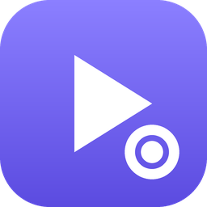
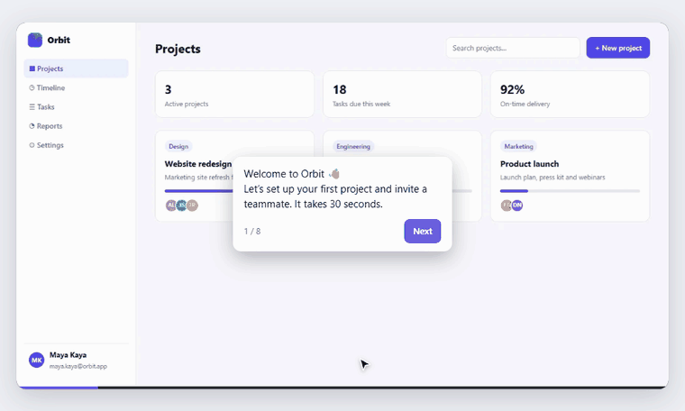
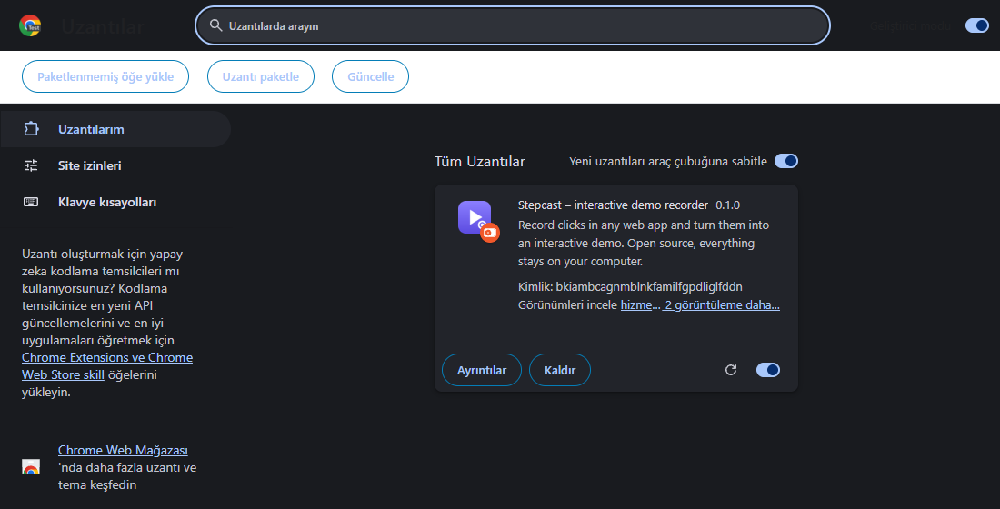
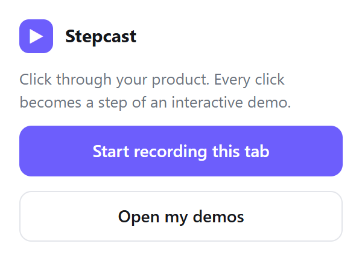
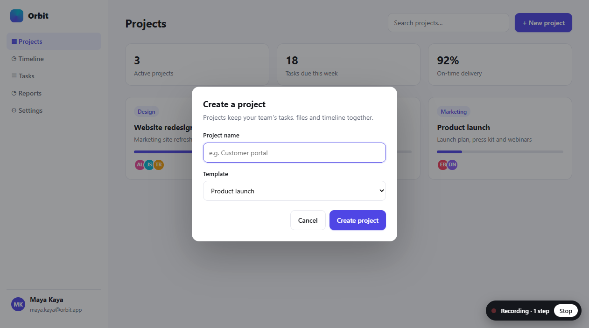
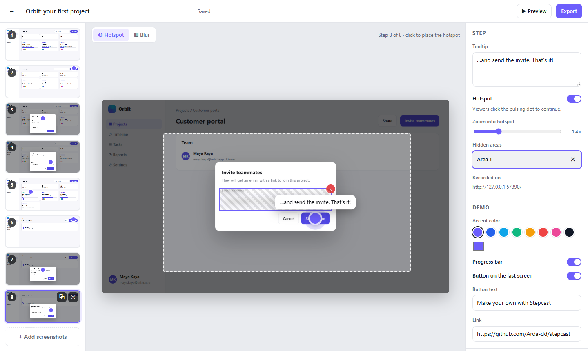
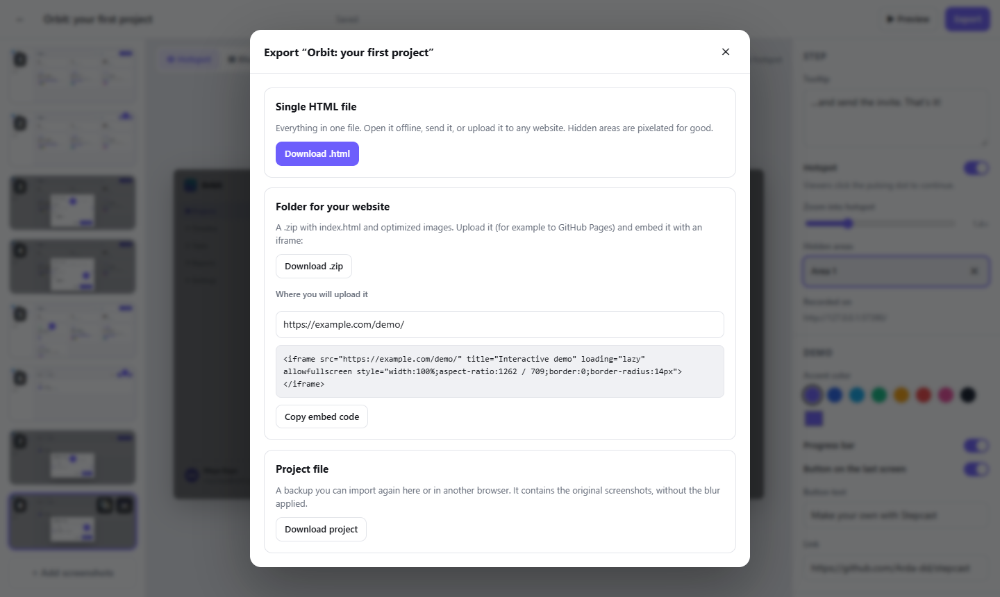

<p align="center"></p>

<h1 align="center">Stepcast</h1>

<p align="center"><b>Bir web sitesinde yaptığın birkaç tıklamayı, izleyenin kendisinin tıklayarak ilerlediği bir demoya dönüştürür.</b><br>
Ücretsiz ve açık kaynak. Hesap yok, abonelik yok. Her şey senin bilgisayarında kalır.</p>

<p align="center">
  <a href="https://arda-dd.github.io/stepcast/"><b>▶ Canlı demoyu dene</b></a> ·
  <a href="#kurulum">Kurulum</a> ·
  <a href="#ilk-demo">İlk demonu hazırla</a> ·
  <a href="#paylaşma">Paylaşma</a> ·
  <a href="#sık-sorulan-sorular">SSS</a> ·
  <a href="README.md">English</a>
</p>

<p align="center"></p>

## Stepcast nedir?

Bunu **izleyenin tıklayarak ilerlediği bir slayt gösterisi** gibi düşün.

Her slayt sitenin bir ekran görüntüsü. Üzerinde basılacak butonu gösteren yanıp sönen bir nokta ve kısa bir not var ("*Yeni proje*'ye tıkla"). İzleyen noktaya tıklayınca sonraki slayt geliyor. Böylece ürünü kendisi kullanarak, kendi hızında öğreniyor ve hiçbir şeyi bozamıyor.

Ekran görüntülerini tek tek almana gerek yok:

1. **Kaydet.** Stepcast'i başlat ve siteni normal şekilde kullan. Her tıklama bir slayt olur.
2. **Düzenle.** Notları yeniden yaz, önemli butonlara yakınlaş, kişisel bilgileri bulanıklaştır.
3. **Paylaş.** Tek bir HTML dosyası indir. Birine gönder ya da sitene koy.

**Kimin işine yarar?**

| Sen… | Şunun için kullan |
| --- | --- |
| yazılımcı ya da ajanssan | müşterine teslim ettiğin yönetim panelinin nasıl kullanılacağını her seferinde telefonda anlatmak yerine bir demo gönder |
| bir girişimsen | sitene, kayıt gerektirmeyen bir "ürünü dene" demosu koy |
| destek ekibindeysen | "şunu nasıl yaparım?" sorularını uzun e-postalar yerine demoyla cevapla |
| eğitmensen | herhangi bir web aracı için birlikte tıklanarak takip edilen dersler hazırla |

**Mevcut araçlardan farkı ne?** Arcade, Supademo ve Storylane aynı işi yapıyor ama [kullanıcı başına ayda 32-50 dolar](https://saltfish.ai/blog/storylane-alternatives) alıyor ve ekran görüntülerini kendi sunucularında tutuyor. Stepcast ücretsiz, her şeyi senin tarayıcında tutuyor ve sana sahibi olduğun bir dosya veriyor.

## Kurulum

Kaydı Chrome eklentisi yapıyor. Kurulum yaklaşık bir dakika sürer ve sadece bir kez yapılır.

> Stepcast Chrome Web Mağazası'nda değil, GitHub'dan kuruluyor. Chrome buna "paketlenmemiş öğe yükleme" diyor. Geliştiricilerin kendi eklentilerini test ederken kullandığı yöntemin aynısı.

**1. İndir.** [Son sürüm sayfasına](https://github.com/Arda-dd/stepcast/releases/latest) git ve *Assets* bölümündeki **`stepcast-extension.zip`** dosyasını indir.

**2. Zip'i aç.** Dosyaya sağ tıkla → **Tümünü ayıkla** (Windows) ya da çift tıkla (Mac). `stepcast-extension` adında bir klasör oluşacak. Bu klasörü silme, Chrome eklentiyi buradan çalıştırıyor.

**3. Eklentiler sayfasını aç.** Chrome'un adres çubuğuna `chrome://extensions` yaz ve Enter'a bas.

**4. Geliştirici modunu aç.** **Sağ üst köşedeki** düğmeyi aç. Solda üç yeni buton belirecek.

**5. Eklentiyi yükle.** **Paketlenmemiş öğe yükle**'ye tıkla ve 2. adımdaki `stepcast-extension` klasörünü seç (klasörün içindeki bir dosyayı değil, klasörün kendisini).

<p align="center"></p>

**6. Sabitle.** Adres çubuğunun yanındaki yapboz ikonuna 🧩 tıkla ve **Stepcast**'in yanındaki raptiyeye bas. Böylece butonu hep görünür.

Bu kadar. ✅

<details>
<summary><b>Edge, Brave, Opera…</b></summary>

Chromium tabanlı her tarayıcıda (sürüm 116 ve üstü) çalışır. Sadece eklentiler sayfasının adresi değişir:

| Tarayıcı | Adres | Geliştirici modu düğmesi |
| --- | --- | --- |
| Chrome | `chrome://extensions` | sağ üst |
| Edge | `edge://extensions` | sol menü |
| Brave | `brave://extensions` | sağ üst |
| Opera | `opera://extensions` | sağ üst |

Firefox ve Safari'de henüz *kayıt* yapılamıyor, ama hazırladığın demoları herkes her tarayıcıda *izleyebilir*.
</details>

<details>
<summary><b>Güncelleme ve kaldırma</b></summary>

- **Güncelleme:** Yeni zip'i indir, eski klasörün üzerine aç (dosyaların yerine geçsin), sonra `chrome://extensions` sayfasındaki Stepcast kartında ↻ yenile ikonuna tıkla. Demoların silinmez.
- **Kaldırma:** Stepcast kartında **Kaldır**'a tıkla. Bu, eklentide kayıtlı demoları da siler, saklamak istediklerini önce dışa aktar.
- Chrome ara sıra geliştirici modundaki uzantılarla ilgili bir uyarı gösterebilir. Uzantıyı devre dışı bırakmadan uyarıyı kapatman yeterli.
</details>

<a id="ilk-demo"></a>

## İlk demonu hazırla

**1. Kaydı başlat.** Göstermek istediğin siteyi aç, araç çubuğundaki Stepcast butonuna tıkla, sonra **Start recording this tab**'e bas.

<p align="center"></p>

**2. Adımları tıkla.** Siteyi birine gösteriyormuş gibi normal şekilde kullan. Sağ alttaki küçük kutu adımları sayar. Onu dert etme, ekran görüntülerinde hiç görünmez.

<p align="center"></p>

İpuçları:
- **Acele etme.** Bir sonraki tıklamadan önce sayfanın değişmesinin bitmesini bekle. Her adım, sayfanın tıklamadan hemen önceki hâlini gösterir.
- **Yazı yazmak bir adım değildir.** Kutuya tıkla, yaz, sonra sıradaki butona tıkla. Sonraki adımda yazdığın görünür.
- Aynı sekmede başka sayfalara geçsen de kayıt devam eder.

**3. Durdur.** Sağ alttaki kutuda (ya da açılır pencerede) **Stop**'a bas. Her tıklamanın bir adım olduğu düzenleyici açılır.

**4. Düzenleyicide son hâlini ver.**

<p align="center"></p>

| Şunu yapmak için… | Bunu yap |
| --- | --- |
| notu değiştirmek | soldan adımı seç, sağdaki **Tooltip** kutusunu düzenle |
| noktayı taşımak | **Hotspot** aracıyla ekran görüntüsüne tıkla ya da sürükle |
| bir butona yakınlaşmak | **Zoom into hotspot** kaydırıcısını oynat; kesikli çerçeve görünecek alanı gösterir |
| e-posta, isim ya da şifre gizlemek | **Blur**'u seç ve üzerine bir kutu çiz |
| tıklamasız bir giriş ya da not eklemek | bir adımı çoğalt (⧉) ve **Hotspot**'u kapat; adım bir yazı kartına dönüşür |
| adımları sıralamak ya da silmek | küçük resimleri sürükle; üzerine gelince ⧉ çoğalt ve ✕ sil çıkar |
| markana uydurmak | **Accent color**'dan renk seç, **Button on the last screen** ile son ekrana buton ekle (ör. "Ücretsiz deneyin") |
| sonucu görmek | **▶ Preview**'a bas (ya da **P** tuşuna) |

Her şey otomatik kaydedilir.

**5. Dışa aktar.** Sağ üstteki **Export**'a tıkla.

<p align="center"></p>

## Paylaşma

**Dosya olarak gönder.** **Download .html**'i seç. Her şeyin içinde olduğu tek bir dosya iner. Kim çift tıklarsa demo tarayıcısında açılır, internet bile gerekmez. E-postayla, WhatsApp'tan ya da Drive'dan paylaşabilirsin.

**Sitene koy.** **Download .zip**'i seç, zip'i aç ve klasörü sitene yükle (örneğin `siten.com/demo/` olarak). Sonra dışa aktarma penceresindeki **gömme kodunu** demonun görünmesini istediğin yere yapıştır:

```html
<iframe src="https://siten.com/demo/" title="Interaktif demo" loading="lazy"
  style="width:100%;aspect-ratio:16 / 9;border:0;border-radius:14px" allowfullscreen></iframe>
```

- **WordPress:** *Özel HTML* bloğu ekle ve kodu yapıştır.
- **Webflow, Wix, Squarespace:** *Embed* / *HTML* öğesini kullan.
- **Sitem yok:** Klasörü [GitHub Pages](https://pages.github.com/) ya da [Netlify Drop](https://app.netlify.com/drop) gibi ücretsiz bir yere yükle (Netlify'da klasörü sürükleyip bırakman yeterli), sonra sana verilen adresi kullan.

**Yedekle ya da başka bilgisayara taşı.** **Download project**'i seç. Daha sonra düzenleyicinin ana ekranındaki **Import project** ile geri yükleyebilirsin.

## Eklentisiz: ekran görüntüleriyle

Elindeki ekran görüntülerinden de demo hazırlayabilirsin, hem de her tarayıcıda: [web düzenleyicisini](https://arda-dd.github.io/stepcast/) aç, **New from screenshots**'a tıkla (ya da görselleri sayfaya sürükle), sonra noktaları yerleştirip notları kendin yaz. Dosyalar adına göre sıralanır, yani `adim-1.png`, `adim-2.png`… doğru sırada gelir.

## Klavye kısayolları

| Düzenleyicide | | Demoda | |
| --- | --- | --- | --- |
| <kbd>H</kbd> | hotspot aracı | <kbd>→</kbd> ya da <kbd>Enter</kbd> | sonraki adım |
| <kbd>B</kbd> | bulanıklaştırma aracı | <kbd>←</kbd> | önceki adım |
| <kbd>↑</kbd> <kbd>↓</kbd> | önceki / sonraki adım | <kbd>Home</kbd> | başa dön |
| <kbd>Delete</kbd> | seçili bulanık alanı sil | | |
| <kbd>P</kbd> | önizleme | | |

## Sık sorulan sorular

<details>
<summary><b>"Start recording this tab" butonu soluk, tıklanmıyor.</b></summary>

Tarayıcılar eklentilerin kendi sayfalarını (`chrome://…`, Chrome Web Mağazası, yeni sekme sayfası) kaydetmesine izin vermiyor. Normal bir web sitesi (`http://` ya da `https://`) açıp tekrar dene. Bilgisayarındaki bir dosyayı (`file://`) kaydetmek için `chrome://extensions` sayfasında Stepcast kartındaki **Ayrıntılar**'a tıkla ve **Dosya URL'lerine erişime izin ver**'i aç.
</details>

<details>
<summary><b>Bir adım, tıklamadan önceki değil sonraki hâli gösteriyor.</b></summary>

Sayfa değiştikten hemen sonra tıklarsan bu olur: Stepcast'in elinde henüz sayfanın durulmuş hâli yoktur ve görüntüyü tıklama anında alır. Kayıt sırasında tıklamalar arasında bir an bekle. Bir adımı her zaman silebilir ya da **+ Add screenshots** ile doğru görüntüyü ekleyebilirsin.
</details>

<details>
<summary><b>Demolarım nerede saklanıyor? Başkası görebilir mi?</b></summary>

Bilgisayarındaki tarayıcı depolamasında. Eklentiyle kaydedilen demolar eklentinin içinde, web sitesinde hazırlananlar o sitenin tarayıcındaki alanında durur. Hiçbir şey internete yüklenmez ve sen dışa aktarılmış bir dosyayı birine gönderene kadar kimse göremez.

Tarayıcı verilerini temizlemek ya da eklentiyi kaldırmak demoları siler. Önemli demoların yedeğini **Download project** ile al.
</details>

<details>
<summary><b>Bulanıklaştırma güvenli mi?</b></summary>

Evet. Dışa aktarırken gizlenen alan, görselin kendisinde büyük renk bloklarıyla değiştirilir. Orijinal yazı dışa aktarılan dosyada hiç bulunmaz ve geri getirilemez. (**Proje dosyası** farklıdır: düzenlemeye devam edebilmen için orijinal görüntüleri saklar. Gizli bilgi içeren proje dosyalarını paylaşma.)
</details>

<details>
<summary><b>Eklenti neden "tüm web sitelerindeki tüm verilerinizi okuyabilir ve değiştirebilir" iznini istiyor?</b></summary>

Chrome bu uyarıyı, senin seçtiğin herhangi bir sitede çalışabilen her eklenti için gösterir. Stepcast sadece *senin* **Start recording**'e bastığın sekmede bir şey yapar: o sekmedeki tıklamalarını fark eder ve ekran görüntüsü alır. Sunucusu yoktur, internete hiçbir şey göndermez ve kodu herkesin inceleyebileceği şekilde açıktır. Bkz. [Gizlilik ve izinler](#gizlilik-ve-izinler).
</details>

<details>
<summary><b>Dışa aktardıktan sonra demoyu değiştirebilir miyim?</b></summary>

Evet. Stepcast'te düzenlemeye devam et ve tekrar dışa aktar. Dışa aktarılan HTML dosyası ise bitmiş bir kopyadır.
</details>

<details>
<summary><b>Demo telefonda çalışır mı?</b></summary>

Evet. Demo her ekran genişliğine uyum sağlar, izleyen noktalara tıklamak yerine dokunur. En iyi sonucu normal bir masaüstü penceresinde kaydettiğinde alırsın.
</details>

## Gizlilik ve izinler

Stepcast'in sunucusu yok ve hiçbir şeyi takip etmiyor. Eklentinin istediği izinler:

| İzin | Neden |
| --- | --- |
| Web sitelerine erişim | kaydediciyi seçtiğin sekmeye eklemek ve oradaki tıklamalarını fark etmek |
| `scripting` | kaydediciyi (ve "Recording" kutusunu) o sekmeye eklemek |
| `tabs` | o sekmenin ekran görüntüsünü almak ve sayfa değişince kayda devam etmek |
| `storage` | bir kaydın devam ettiğini hatırlamak |

Dışa aktarılan demolar internetten hiçbir şey yüklemez: yazı tipi yok, betik yok, analiz yok.

## Geliştiriciler için

Nasıl çalıştığı, oynatıcının kendi sayfanda nasıl kullanılacağı ve geliştirme komutları için [İngilizce README](README.md#how-it-works)'ye bak.

## Lisans

[MIT](LICENSE). Kişisel ve ticari kullanım için ücretsiz.
